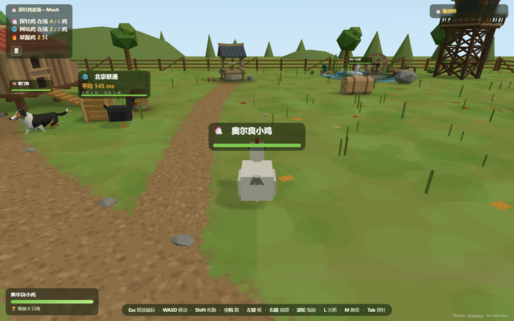
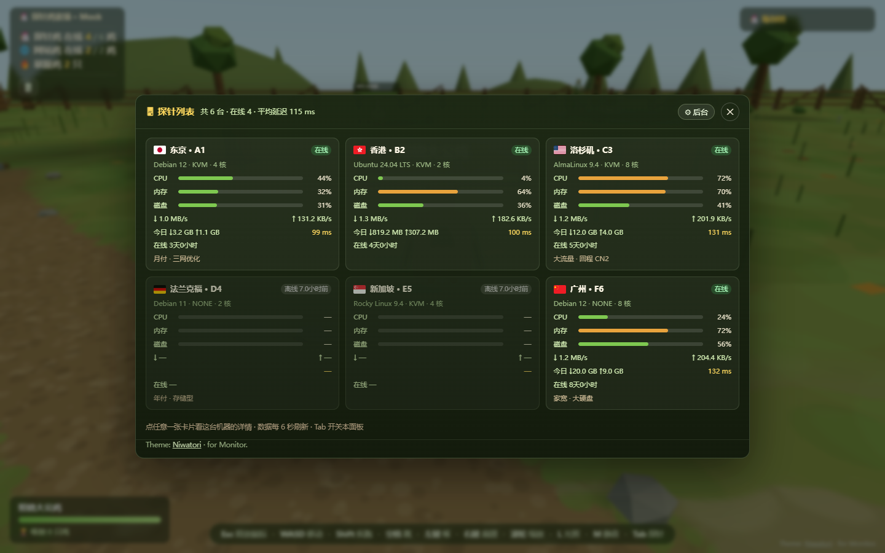
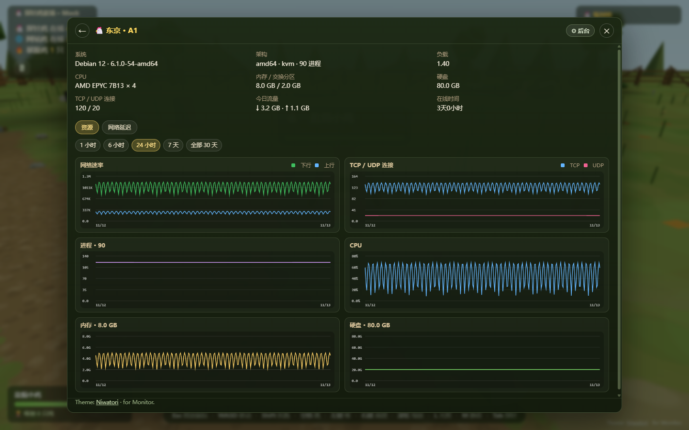
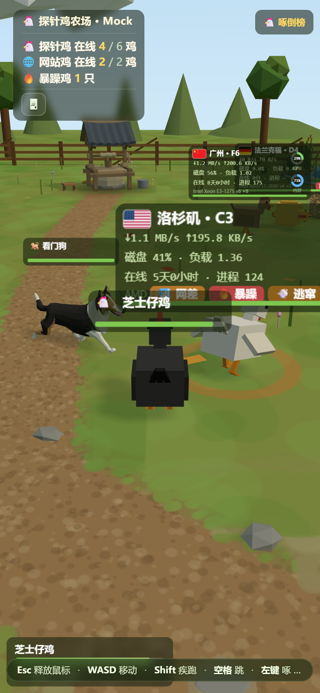
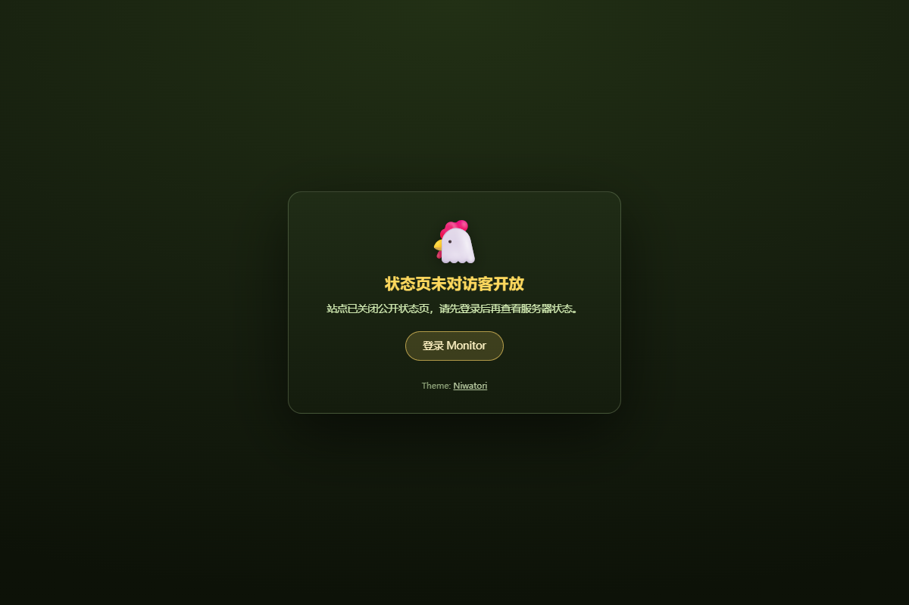

# niwatori · 探针鸡农场（Monitor 主题）


把 [Monitor](https://github.com/monitor-probe/monitor) 的实时监控数据做成一座可玩的 3D 小鸡农场：
每台机器一只**探针鸡**（国旗、CPU/内存双环、网速、磁盘、负载、在线时长、机型），
每个 ping 任务一只**网站鸡**（平均延迟、最好/最差节点、丢包）。农场就是主题首页；
首页固定是农场；`Tab` / 顶栏 🖥 / `/nodes` 打开**原版 Cyber-Probe 的 1000px 居中悬浮层**（农场在背后暂停并模糊），
点卡片进详情悬浮层（同一块面板放宽到 1160px）；详情里 `Tab` 回列表，列表再 `Tab` / ✕ 回农场。
曲线浮框跟着鼠标走，靠近卡片右/下边缘会自动翻到左上，不会越出面板。

农场里的鸡舍、水塔、树、拖拉机、驴、看门狗等道具用的是 **精细低模**
（GLB，CC BY 4.0；署名保留在每个模型的  元数据里），按真实世界米摆位，始终开启；
模型始终开启（包内自带，没有后台开关）；个别模型加载失败会逐件退回自建低模。

前端来自同一作者的 [cyber-probe](https://github.com/akanotanin/cyber-probe)（MIT）——
原版是「独立站点 + 一键安装器 + 联机服」，这个主题把它**收进 Monitor 主题包**里：
不再需要单独部署 `/chicken/`，也不再需要 Node/Python 侧的服务，只要一个主题 tar.gz。

## 三张页面

| 农场 `/` | 探针列表 `/nodes`（悬浮层） | 节点详情 `/node/<id>` |
|:---:|:---:|:---:|
|  |  |  |

| 手机竖屏 | 站点关闭公开页 |
|:---:|:---:|
|  |  |

## 装进 Monitor

主题按 Monitor 的格式打包：解压后根目录是 `theme.json` + `dist/`，面板里直接上传 tar.gz 即可。

```bash
npm run check      # 自检：theme.json / 标题占位 / 资源 / 设置默认值 / 模型与署名
npm run package    # → release/monitor-theme-niwatori-1.0.4.tar.gz（打印 SHA-256）
```

- 后台 → **主题** → 上传 `theme.tar.gz`；
- 主题设置需要 **Monitor hub 1.6.0+**（更老的版本没有 `config` 表单，主题照常跑，只是全部用默认值）；
- `/admin` 仍由 hub 内置界面接管，主题不碰；
- hub 对找不到的静态文件回 `index.html`，所以 `/nodes` 与 `/node/123` 刷新也能直接进；
  列表与详情都是悬浮层，刷新后农场仍会在背后加载/暂停；
- `/api/me` 的 `public_page` 关掉且访客未登录时，主题只给一张登录卡（不加载 3D）。

## 设置

后台「主题 → 主题设置」里可调（存 `/api/themes/niwatori/config`，公开页通过同一路径读回）：

| 设置 | 默认 | 说明 |
|---|:---:|---|
| 网站鸡 | 开 | 每个 ping 任务生成一只网站鸡；关掉后场上只有探针鸡，网站鸡统计一起收起 |
| 大白鹅数量 | 2 | 0–8 只巡场大白鹅，有领地意识，会追着玩家啄 |
| 看门狗数量 | 1 | 0–3 只，只咬暴躁鸡和大白鹅，不咬玩家、打不倒 |
| 暴躁鸡 · CPU 阈值 | 55 | CPU 超过它的探针鸡会主动追人 |
| 暴躁鸡 · 内存阈值 | 85 | 内存超过它的也会 |
| 最多暴躁鸡 | 0 | 0 = 不限；>0 时按 CPU/内存压力取前 N 只 |
| 光照 | 自动 | 自动 = 北京时间 18:00–06:00 黄昏，其余白天；访客按 `L` 可自己切 |
| 音效 | 开 | WebAudio 现场合成，不加载音频文件；浏览器要等第一次点击/按键后才有声；`M` 静音 |

## 精细模型与署名

`dist/vendor/models/` 里是 29 个精细低模（鸡舍、水塔、树、拖拉机、驴、看门狗…），
加载器是 [glb-models.js](dist/js/glb-models.js)（GLTFLoader + SkeletonUtils）。

**许可**：这些 `.glb` 采用 **CC BY 4.0**，可以随作品再分发；每件模型在 `asset.copyright`
和 `asset.extras` 里保留了完整署名、许可与来源，随文件一起分发，**不要剥离**。
原版的 `.mjs` 模块许可不允许再分发，所以本主题没有使用它 —— 直接读 GLB。
想重新下载/更新模型：`MODEL_CDN=https://…/cdn/ node scripts/fetch-models.mjs`；
`--check` 只查缺和内置署名元数据。

## 玩法（单机 + NPC）

主题**不带联机服**：没有 WebSocket 房间、没有啄倒榜上的其他玩家。农场由客户端自己养：

- **探针鸡 / 网站鸡**：闲逛、啄地、振翅；CPU/内存超阈值或网络最差的会变「暴躁鸡」，追着你啄；
  挨打后 45% 概率逃窜、其余回头反击；6 秒没挨打开始缓慢回血；被啄倒 6 秒后满血复活。
- **大白鹅**：守着自己那片地，你走进 2.5 m 就追；60 血、一口 6 点、被打会还嘴。
- **看门狗**：鸡舍门口溜达，看到大白鹅或暴躁鸡冲过去咬（把目标推开 1.5 m），不咬玩家。
- **你**：左键啄 12 点、右键扇翅 8 点（击退）；被啄倒 3.5 秒后满血复活；左下角是血条与啄倒数，
  右上角「啄倒榜」在单机模式下就是你的战绩板。

数值尽量对齐原版 `server/farm_server.py`（`PROBE_HP=100`、`PECK_DMG=12`、`WING_DMG=8`、
`PROBE_HOT_DMG=9`、`GOOSE_HP=60`…）。想改在 `dist/js/solo.js` 顶部的常量里改。

为什么不做多人：Monitor 主题是纯静态包，带不了 `farm_server.py`；而「主题里塞一个外部联机服」
会把一个开着就能看的监控页变成需要另配反代的半成品。单机这一版已经保留了农场最要紧的东西：
鸡、数据、啄击、大白鹅与看门狗。

## 与 cyber-probe 原版的差异

| 原版 | 这个主题 |
|---|---|
| 独立站点，装在 `/chicken/`，nginx/Caddy 反代 | Monitor 主题 tar.gz，挂在站点根目录 |
| `tools/gen_config.py` 生成 `js/config.js` | `SOURCE = monitor`，运行时读 `/api/me`、`/api/nodes`、`/api/nodes/{id}/metrics` |
| 一键安装器 / systemd / 联机服 | 没有；`js/solo.js` 在本地养鸡与结算 |
| 顶栏只有统计与 🖥 悬浮层 | 多一个站名、主题署名；`/nodes`、`/node/<id>` 是可刷新、可分享的地址 |
| 原版按需下载 .mjs 模块、不回仓库 | 改用 GLB（CC BY 4.0）随包分发，署名内置在模型文件中；始终开启、无后台开关 |
| 国旗在安装时下载 | 250 面国旗已随包（`dist/vendor/flags`） |
| 访客点鸡 → 悬浮层详情 | 点鸡 → 详情页（地址栏同步），`Tab` 在农场与列表之间来回 |
| 访客随机出生 | 单机默认落在场地中央的开阔处（避免镜头塞进鸡舍/树里）；`?spawn=9,13&yaw=-2.1` 可覆盖 |
| 探针列表是原版 1000px 悬浮层 | 同款：列表 1000px，详情同一块悬浮层放宽到 1160px，不再另做整页 |

## 数据与隐私

只读同源 Monitor 公开接口，没有任何第三方运行时请求（three.js、国旗、模型、图标都在包里）：

- `GET /api/me` → 站名、`public_page`、`authed`、`history_days`；
- `GET /api/themes/niwatori/config` → 站长在后台存的玩法设置；
- `GET /api/nodes` → 节点列表与实时指标（每 6 秒轮询）；
- `GET /api/nodes/{id}/metrics?hours=&points=` → 详情页的历史曲线；`&series=ping` → 各探测点延迟。

页面上不显示主机名/IP、探测目标域名；只有节点名、公开备注、国家、系统、机型与读数。
`/admin` 入口只在后台存在时出现（前端探测 `HEAD /admin/`，404 就藏掉）。

## 本地开发

不需要真 hub，`scripts/mock-hub.mjs` 自带一套假数据（6 台节点、2 个 ping 任务、30 天历史）：

```bash
npm run mock        # http://127.0.0.1:18099
npm run verify      # 需要一个开着 --remote-debugging-port=9333 的 Chrome
npm run check       # 不开浏览器也能查打包问题
npm run package     # 生成 release/*.tar.gz
MODEL_CDN=https://…/cdn/ node scripts/fetch-models.mjs   # 重新下载/补齐模型
```

mock 还带两个开关，用来验收边界：

```bash
node scripts/mock-hub.mjs --port 18100 --closed      # public_page=false → 登录卡
```

`verify` 用 CDP 打开 `/`、`/?light=day`、`/nodes`、`/node/1`、手机竖屏，并验证 `Tab` 切路由、
详情里 Tab 回列表、浏览器后退、站点关闭公开页、精细模型加载数量。启动 Chrome 的例子：

```bash
chrome --headless=new --enable-unsafe-swiftshader \
       --remote-debugging-port=9333 --user-data-dir=/tmp/chrome-cp about:blank
BASE=http://127.0.0.1:18099 SHOTS=./shots npm run verify
```

预览图用同一套 mock 重新生成（会等模型加载完再截）：

```bash
PREVIEW_SPAWN='0,0' PREVIEW_YAW='3.1416' PREVIEW_OUT=./preview.png node scripts/preview-shot.mjs
```

## 已知限制

- 需要 WebGL；不支持 WebGL 的浏览器只会看到加载提示，没有降级列表页；
- 数据是 6 秒轮询（原版 cyber-probe 的 Monitor 模式就是轮询；hub 的 WS 推送没有接进农场）；
- `/nodes` 深链会先把 3D 农场也加载起来（面板后面暂停），所以第一次打开列表仍有模型下载成本；
- 主题只对接 Monitor（`dist/js` 里还留着 Komari / 哪吒的适配代码，但配置固定 `SOURCE=monitor`，
  `theme-boot.js` 也只读 Monitor 的设置接口）；
- 精细模型始终开启，约 5 MB，首次进站要下载；模型文件缺失时才退回 `world.js` 的自建低模；
- 鸡本身仍是 cyber-probe 原来的方块鸡（精细的是农场道具与看门狗）；
- 没有多人：`net.js` 还在，但 `CP_THEME.multiplayer` 固定为 `false`，浏览器不会去连 `./ws`。

## 许可

- 主题代码：MIT，见 [LICENSE](LICENSE)；上游 [cyber-probe](https://github.com/akanotanin/cyber-probe) 同为 MIT；
- three.js r169：MIT，`dist/vendor/three.module.js`；
- 国旗 PNG：来自 [flagcdn](https://flagcdn.com/)（公有领域），`dist/vendor/flags/`；
- 精细模型：GLB，CC BY 4.0；完整署名、许可与来源保留在每件文件的 `asset.copyright` / `asset.extras` 中；
- 预览图里的数据来自本地 mock，不是任何真实站点。
