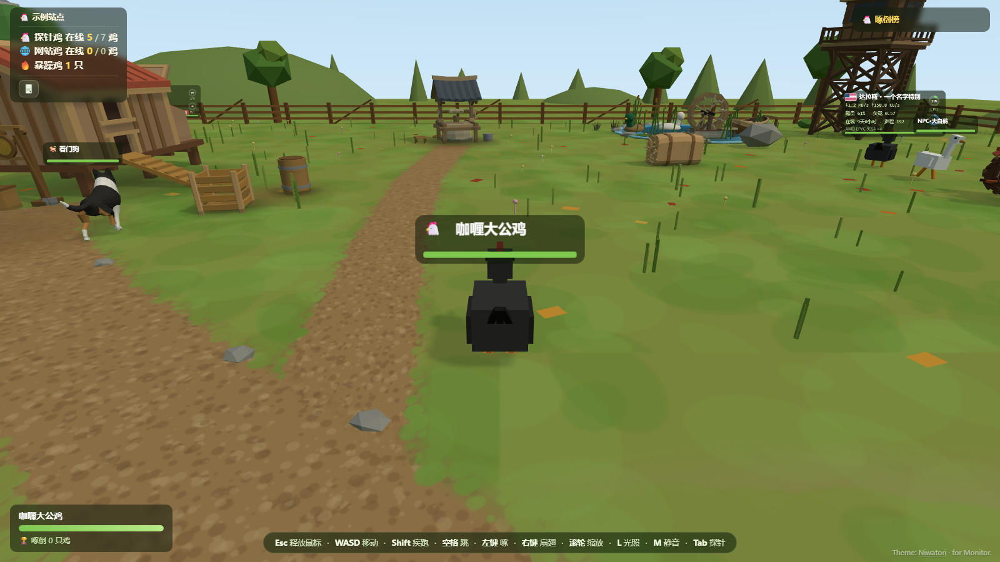

# niwatori

把 [Monitor](https://github.com/monitor-probe/monitor) 的实时监控数据做成一座可玩的 3D 小鸡农场。



- 每台机器一只**探针鸡**：国旗、CPU/内存双环、网速、磁盘、负载、在线时长、机型
- 每个 ping 任务一只**网站鸡**：平均延迟、最好/最差节点、丢包
- 农场是首页；`Tab` / 顶栏 🖥 / `/nodes` 打开 1000px 列表悬浮层，点卡片进 1160px 详情悬浮层，详情里 `Tab` 回列表
- 单机玩法：大白鹅、看门狗、暴躁鸡、啄击/扇翅、啄倒榜；没有联机服
- 服务器卡片：资源条下是一块网络信息（网速 + 今日流量、三网延迟/丢包），在线时长收进悬停提示
- 离线 / 无数据卡片沉底；列表与详情的滚动条统一成悬浮窗同款细玻璃条
- 曲线浮框跟随鼠标，靠近卡片边缘会自动翻转
- 农场道具为精细低模（GLB，CC BY 4.0），随包分发、始终开启
- **像素载入动画**：首屏不是干等一条提示 —— 像素胶囊里小鸡一趟趟搬稻草，鸡舍按**真实加载进度**一层层搭起来（石基 → 木构架 → 红墙板 → 门楣门洞 → 三段铺瓦 → 开窗 → 点灯 → 挂彩旗），草垛、栅栏、水井、野花跟着冒出来；100% 时门洞透暖光、屋檐彩旗挂满、邻居小鸡跑来，幕布才淡出。点击画布上的小鸡它会跳一下
- 只读同源 Monitor 公开接口，没有第三方运行时请求

## 安装

需要 **Monitor hub 1.5.2+**（已在 v1.5.2 上实测：`/api/me`、`/api/nodes`、`/api/nodes/{id}/metrics`、
`/api/themes/<short>/config`、主题安装与 SPA 回退都在这个版本里）。

1. 从 [Releases](https://github.com/akanotanin/monitor-theme-niwatori/releases) 下载 `monitor-theme-niwatori-1.0.20.tar.gz`
2. 后台 → 主题 → 上传 tar.gz
3. 可选设置：网站鸡、大白鹅/看门狗数量、暴躁鸡阈值、光照、音效

`/admin` 由 hub 接管；站点关闭公开页时，访客只会看到登录卡。

## 本地开发

```bash
npm run check        # 静态自检（配置、资源、模型、署名）+ 脱敏自检
npm run check:leaks  # 只跑脱敏自检（读本机 .leaklist，可选；不提交）
npm run mock         # 假 hub：http://127.0.0.1:18099（默认端口）
npm run verify       # 需要 Chrome 开着 --remote-debugging-port=9333（Node 22+：脚本用全局 WebSocket）
npm run package      # release/*.tar.gz
```

载入动画专项（11 项）要另外起一个静态服务，因为预览页 `tools/ld-preview.html` 不在 `dist/` 里
（`mock` 只伺服 `dist/`，直接访问会 404）。任选一个：

```bash
npx --yes serve -l 5210 .          # 或者
python -m http.server 5210         # 或者仓库自带的 node 一行服务

CDP_PORT=9333 BASE=http://127.0.0.1:18099 \
  PREVIEW=http://127.0.0.1:5210/tools/ld-preview.html npm run check:loading
```

脱敏自检（`scripts/check-leaks.mjs`）会扫工作区与全部提交信息，查本机绝对路径、非 noreply 邮箱、IPv4、
运维命令痕迹；仓库根目录若放了 `.leaklist`（一行一个私有域名/主机别名，已 gitignore），这些词也一起扫。

Chrome 示例：

```bash
# ★ 不要加 --use-angle=swiftshader：本机实测它会让 Page.captureScreenshot 随机卡死 30s+，
#   表现为 cdp-verify 打到截图那步就 "CDP timeout"。默认 GPU 路径反而稳。
chrome --headless=new --remote-debugging-port=9333 --user-data-dir=/tmp/chrome-niwatori about:blank
```

## 结构

```
theme.json    Monitor 主题清单与设置
dist/         页面、3D 农场、模型、国旗
scripts/      mock hub、打包、自检、CDP 验证
shots/        截图
```

## 许可

- 主题代码 MIT，见 [LICENSE](LICENSE)；上游 [cyber-probe](https://github.com/akanotanin/cyber-probe) 同为 MIT
- three.js r169：MIT（全文在 [THIRD-PARTY-NOTICES.md](THIRD-PARTY-NOTICES.md)，随发布包分发）
- 国旗：flagcdn（flagpedia.net）的免费国旗库，上游说明其图像取自 Wikimedia Commons 的公有领域国旗图
- 精细模型：GLB，CC BY 4.0；完整署名、许可与来源保留在每个文件的 `asset.copyright` / `asset.extras` 中，分发时请勿剥离
