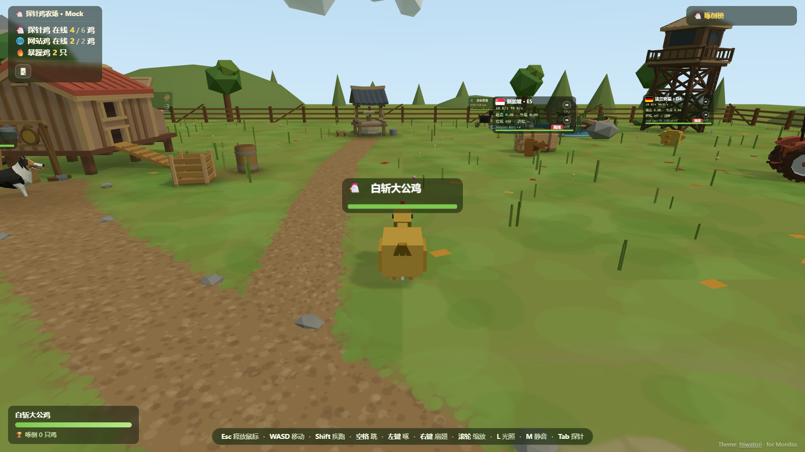

# niwatori

把 [Monitor](https://github.com/monitor-probe/monitor) 的实时监控数据做成一座可玩的 3D 小鸡农场。



- 每台机器一只**探针鸡**：国旗、CPU/内存双环、网速、磁盘、负载、在线时长、机型
- 每个 ping 任务一只**网站鸡**：平均延迟、最好/最差节点、丢包
- 农场是首页；`Tab` / 顶栏 🖥 / `/nodes` 打开 1000px 列表悬浮层，点卡片进 1160px 详情悬浮层，详情里 `Tab` 回列表
- 单机玩法：大白鹅、看门狗、暴躁鸡、啄击/扇翅、啄倒榜；没有联机服
- 曲线浮框跟随鼠标，靠近卡片边缘会自动翻转
- 农场道具为精细低模（GLB，CC BY 4.0），随包分发、始终开启
- 只读同源 Monitor 公开接口，没有第三方运行时请求

## 安装

需要 **Monitor hub 1.6.0+**。

1. 从 [Releases](https://github.com/akanotanin/monitor-theme-niwatori/releases) 下载 `monitor-theme-niwatori-1.0.8.tar.gz`
2. 后台 → 主题 → 上传 tar.gz
3. 可选设置：网站鸡、大白鹅/看门狗数量、暴躁鸡阈值、光照、音效

`/admin` 由 hub 接管；站点关闭公开页时，访客只会看到登录卡。

## 本地开发

```bash
npm run check      # 静态自检（配置、资源、模型、署名）
npm run mock       # http://127.0.0.1:18099
npm run verify     # 需要 Chrome 开着 --remote-debugging-port=9333
npm run package    # release/*.tar.gz
```

Chrome 示例：

```bash
chrome --headless=new --enable-unsafe-swiftshader \
       --remote-debugging-port=9333 --user-data-dir=/tmp/chrome-niwatori about:blank
```

## 结构

```
theme.json    Monitor 主题清单与设置
dist/         页面、3D 农场、模型、国旗
scripts/      mock hub、打包、自检、CDP 验证
shots/        截图
```

## 许可

- 主题代码 MIT，见 [LICENSE](LICENSE)；上游 [cyber-probe](https://github.com/akanotanin/cyber-probe) 同为 MIT
- three.js r169：MIT
- 国旗：flagcdn（公有领域）
- 精细模型：GLB，CC BY 4.0；完整署名、许可与来源保留在每个文件的 `asset.copyright` / `asset.extras` 中，分发时请勿剥离
